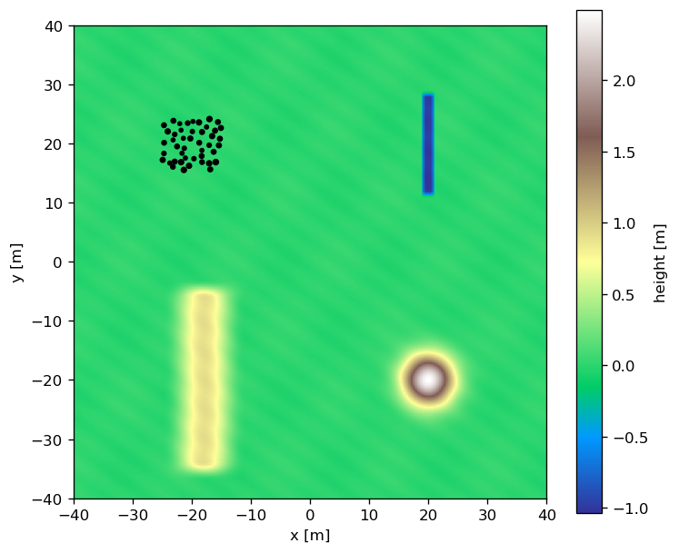

# Terrain-Aware Outdoor Navigation

A ROS 2 project for navigating a 4-wheel rover over uneven outdoor terrain.
The robot builds an elevation map from 3D LiDAR, turns it into a
traversability map (slope, roughness, step height) and feeds that into a
custom Nav2 costmap layer, so it avoids steep hills and rocks that a flat
2D costmap cannot see.

> **Status:** work in progress. Simulation, localization, elevation and
> traversability mapping, and the baseline Nav2 stack are done. The custom
> costmap layer and the benchmark are next (see [docs/roadmap.md](docs/roadmap.md)).

| | |
|---|---|
| ROS distro | ROS 2 Humble |
| Simulator | Gazebo Fortress (Ignition Gazebo 6) via `ros_gz` |
| Navigation | Nav2 |
| Localization | `robot_localization` EKF (wheel odom + IMU + GPS) |
| Mapping | `grid_map` elevation and traversability layers |

## Repository layout

```
terrain_aware_navigation/
├── terrain_nav_description/     # Robot model
│   ├── urdf/
│   │   ├── rover.urdf.xacro     # Top-level model
│   │   ├── properties.xacro     # Dimensions, masses, inertia macros
│   │   ├── chassis.xacro        # base_footprint + base_link
│   │   ├── wheel.xacro          # Wheel + continuous joint macro
│   │   ├── sensors.xacro        # 3D LiDAR, IMU, GPS (+ Gazebo sensors)
│   │   └── gazebo.xacro         # Skid-steer drive + joint state plugins
│   ├── launch/display.launch.py # Model in RViz only
│   └── rviz/rover.rviz
├── terrain_nav_gazebo/          # Simulation
│   ├── worlds/
│   │   ├── outdoor_terrain.sdf  # 80 m x 80 m test terrain (default)
│   │   └── empty_terrain.sdf    # Flat, geo-referenced baseline world
│   ├── models/outdoor_terrain/  # Generated terrain mesh + rocks
│   ├── scripts/generate_terrain.py
│   ├── config/scenarios.yaml    # Start/goal pair per test area
│   ├── config/bridge.yaml       # ROS <-> Gazebo topic bridge
│   └── launch/sim.launch.py     # Gazebo + robot + bridge + RViz
├── terrain_nav_mapping/         # Elevation + traversability (C++, grid_map)
│   ├── src/traversability.cpp   # Slope / roughness / step / cost
│   ├── src/elevation_mapper_node.cpp
│   ├── test/                    # gtest on synthetic terrain
│   └── scripts/save_map_snapshot.py
├── terrain_nav_navigation/      # Nav2 configs + full-stack bringup
│   ├── config/nav2_default.yaml # Baseline: 2D obstacle layer (LiDAR ring)
│   ├── launch/bringup.launch.py # Gazebo + EKF + mapping + Nav2 + RViz
│   └── rviz/nav.rviz
├── terrain_nav_localization/    # robot_localization
│   ├── config/ekf.yaml          # Local EKF, global EKF, navsat_transform
│   └── launch/localization.launch.py
└── docs/roadmap.md
```

## Robot

4-wheel skid-steer rover, 0.8 m x 0.5 m chassis, 0.15 m wheels, about 27 kg.

| Sensor | Gazebo type | ROS topic | Message | Rate |
|---|---|---|---|---|
| 3D LiDAR (16 beams, ±15°, 30 m) | `gpu_lidar` | `/lidar/points` | `sensor_msgs/PointCloud2` | 10 Hz |
| | | `/lidar/scan` | `sensor_msgs/LaserScan` | 10 Hz |
| IMU | `imu` | `/imu/data` | `sensor_msgs/Imu` | 100 Hz |
| GPS | `navsat` | `/gps/fix` | `sensor_msgs/NavSatFix` | 5 Hz |

Other topics: `/cmd_vel` (in), `/odom` (wheel odometry), `/joint_states`,
`/tf`, `/clock`, `/ground_truth/odom` (Gazebo world pose, used only for
evaluation).

## Localization

Two `robot_localization` EKFs run in full 3D (`two_d_mode: false`), because
z, roll and pitch matter on hills:

| Node | Inputs | Output | TF |
|---|---|---|---|
| `ekf_local` | wheel odom (vx, vy, vz) + IMU (roll, pitch, yaw, rates) | `/odometry/local` | `odom -> base_footprint` |
| `navsat_transform` | `/gps/fix` + IMU + `/odometry/global` | `/odometry/gps` | |
| `ekf_global` | the above + GPS x/y | `/odometry/global` | `map -> odom` |

TF tree: `map -> odom -> base_footprint -> base_link -> {wheels, lidar_link, imu_link, gps_link}`.

After 24 m of curved driving across the ridge, the global estimate is about
0.4 m from ground truth.

```bash
ros2 launch terrain_nav_gazebo sim.launch.py publish_odom_tf:=false
ros2 launch terrain_nav_localization localization.launch.py
```

## Test terrain



`scripts/generate_terrain.py` builds the terrain from a fixed seed, so every
run sees the same world. Each quadrant targets one failure mode of a flat 2D
costmap:

| Area | Hazard | Why a 2D LiDAR ring misses it |
|---|---|---|
| `rock_field` (NW) | 45 rocks sticking out 0.22-0.32 m | Rocks sit below the 0.42 m scan plane but above the 0.14 m ground clearance |
| `ditch` (NE) | 1 m deep, 2 m wide trench | Negative obstacles return no hits in a horizontal scan |
| `gentle_ridge` (SW) | 0.9 m ridge, ~11° slopes, **safe to cross** | Rising ground shows up as a false wall |
| `steep_hill` (SE) | 2.5 m hill, up to ~27° | Only the upper part is seen, so the robot clips the steep flanks |

Start/goal pairs are in `terrain_nav_gazebo/config/scenarios.yaml`.
To regenerate the terrain (and the map image):

```bash
python3 terrain_nav_gazebo/scripts/generate_terrain.py --preview
```

## Elevation and traversability mapping

`elevation_mapper_node` (C++) turns `/lidar/points` into a 40 m x 40 m,
0.2 m `grid_map` that stays centred on the robot, in the `odom` frame:

1. Transform each cloud into `odom` and drop self-hits (< 0.9 m) and sparse far points (> 12 m).
2. Keep the highest point per cell for each scan, then blend it into the map (EMA, alpha = 0.5).
3. At 2 Hz, compute per cell:
   - **slope**: angle of a least-squares plane over 1.0 m x 1.0 m
   - **roughness**: RMS residual of that plane
   - **step**: max - min height over 0.6 m x 0.6 m
   - **traversability** = `clamp(max(slope/20°, roughness/0.08 m, step/0.15 m), 0, 1)`
4. Publish `grid_map_msgs/GridMap` on `/elevation_map`.

One dangerous term is enough to make a cell lethal. The gentle 11° ridge
costs about 0.55 (passable), while rocks, ditch walls and the steep hill
reach 1.0. Limits are in `terrain_nav_mapping/config/elevation_mapper.yaml`.

```bash
ros2 launch terrain_nav_mapping mapping.launch.py
ros2 run terrain_nav_mapping save_map_snapshot.py --out map.png
```

## Navigation

`terrain_nav_navigation/launch/bringup.launch.py` starts the whole stack:
Gazebo, both EKFs, the elevation mapper, Nav2 and RViz.

The baseline (`mode:=default`) is a typical flat-world Nav2 setup:
- Navfn (A*) global planner with unknown space allowed
- Regulated Pure Pursuit controller at 0.6 m/s
- obstacle layer on `/lidar/scan` (the horizontal ring of the 3D LiDAR) plus inflation

```bash
ros2 launch terrain_nav_navigation bringup.launch.py mode:=default x:=-30 y:=20
```

Use **2D Goal Pose** in RViz. The `map` frame starts at the spawn pose.

## Build

```bash
mkdir -p ~/terrain_nav_ws/src && cd ~/terrain_nav_ws/src
git clone https://github.com/MOHANsundar007/terrain_aware_navigation.git
cd ~/terrain_nav_ws
rosdep install --from-paths src --ignore-src -r -y
colcon build --symlink-install
source install/setup.bash
```

## Run

Gazebo, the robot and RViz:

```bash
ros2 launch terrain_nav_gazebo sim.launch.py
```

Spawn in a test area, e.g. in front of the ditch:

```bash
ros2 launch terrain_nav_gazebo sim.launch.py x:=10 y:=20
```

Launch arguments: `world:=<abs path>`, `headless:=true`, `rviz:=false`,
`publish_odom_tf:=false` (when the EKF runs), `x:= y:= z:= yaw:=` (spawn pose).

Drive it:

```bash
ros2 run teleop_twist_keyboard teleop_twist_keyboard
```

Model only (no simulator):

```bash
ros2 launch terrain_nav_description display.launch.py
```

## Testing

```bash
colcon test --packages-select terrain_nav_description terrain_nav_mapping
colcon test-result --verbose
```

- `terrain_nav_description`: expands the xacro and runs `check_urdf`
- `terrain_nav_mapping`: gtest for flat ground, a 10° plane (slope and cost
  0.5), a 30 cm ledge (lethal) and unknown cells
