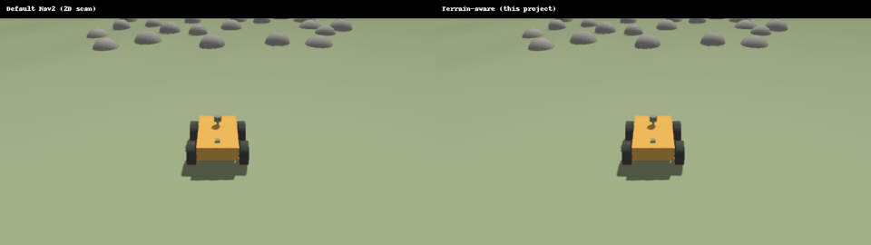
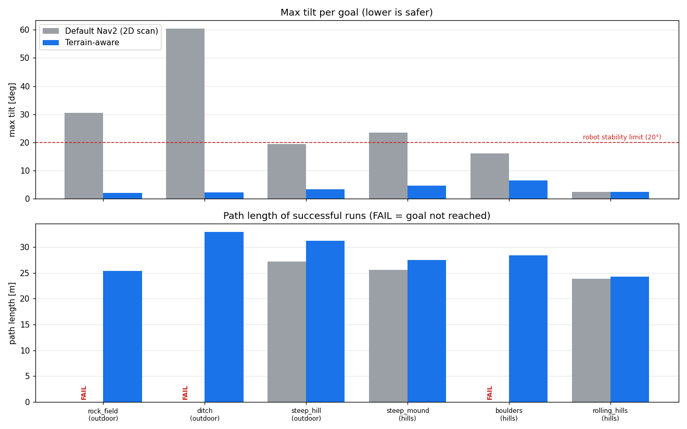
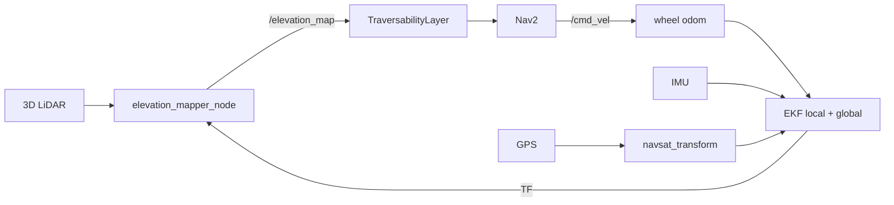
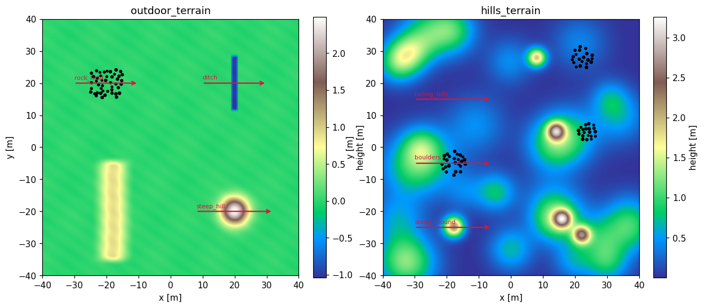

# Terrain-Aware Outdoor Navigation


Outdoor navigation for a 4-wheel rover in ROS 2 Humble, Gazebo Fortress and Nav2.

Stock Nav2 with a 2D laser scan can't see low rocks, ditches or how steep a
slope is. This project builds an elevation map from a 3D LiDAR, computes
slope / roughness / step height per cell, and feeds that into Nav2 through
a custom costmap layer (C++).



Rock field, 4x speed. Left: default Nav2 drives into the rocks and gets stuck
at 30° tilt. Right: terrain-aware drives around them (max tilt 2°).

## Results

Same 6 goals, same planner and controller, only the costmap is different.
One run per goal.

| World | Goal | Default Nav2 | Terrain-aware |
|---|---|---|---|
| outdoor | `rock_field` | no (stuck) / 12.1 m / 30° | yes / 25.4 m / 2° |
| outdoor | `ditch` | no (tipped) / 9.4 m / 60° | yes / 32.9 m / 2° |
| outdoor | `steep_hill` | yes / 27.1 m / 19° | yes / 31.2 m / 3° |
| hills | `steep_mound` | yes / 25.6 m / 23° | yes / 27.5 m / 5° |
| hills | `boulders` | no (stuck) / 8.9 m / 16° | yes / 28.4 m / 6° |
| hills | `rolling_hills` | yes / 23.8 m / 2° | yes / 24.2 m / 2° |
| **All** | | **3/6**, mean max tilt 25° | **6/6**, mean max tilt 3° |

Each cell is: reached / path length / max tilt (from Gazebo ground truth).



Default Nav2 gets stuck on the rocks and boulders because they sit under the
scan plane, and it drives straight into the ditch and flips. It does make it
over the steep hill and mound, but tilts 19° and 23° doing it (the rover is
rated to about 20°). On the rolling hills both behave the same.

The terrain-aware paths are longer because of the detours: 8% longer on the
3 goals both versions reached.

Raw data is in [`docs/results/benchmark.csv`](docs/results/benchmark.csv).

## Packages

| Package | |
|---|---|
| `terrain_nav_description` | Rover URDF/xacro (skid steer, 16-beam LiDAR, IMU, GPS) |
| `terrain_nav_gazebo` | Worlds, terrain generator, ROS–Gazebo bridge, sim launch |
| `terrain_nav_localization` | robot_localization: local EKF, global EKF + GPS |
| `terrain_nav_mapping` | Elevation map + traversability on grid_map (C++) |
| `terrain_costmap_plugin` | Nav2 costmap layer that reads the traversability map (C++) |
| `terrain_nav_navigation` | Nav2 params (default / terrain) and the bringup launch |
| `terrain_nav_benchmark` | Benchmark script and demo GIF recorder |



## Robot

Skid steer, 0.8 x 0.5 m, 0.15 m wheels, ~27 kg, 0.14 m ground clearance.

| Sensor | Topic | Rate |
|---|---|---|
| 3D LiDAR, 16 beams, ±15° | `/lidar/points`, `/lidar/scan` (middle ring) | 10 Hz |
| IMU | `/imu/data` | 100 Hz |
| GPS | `/gps/fix` | 5 Hz |
| Wheel odometry | `/odom` | 50 Hz |

`/ground_truth/odom` is only used by the benchmark, it's not fused.

## Localization

Two EKFs from robot_localization, both with `two_d_mode: false` since the
robot drives on hills.

- `ekf_local`: wheel odom + IMU → `odom → base_footprint`
- `ekf_global`: wheel odom + IMU + GPS (via `navsat_transform`) → `map → odom`

Over 24 m of driving across a ridge the global estimate was off by about 0.4 m.

## Elevation map and traversability

`elevation_mapper_node` keeps a 40 x 40 m grid_map at 0.2 m around the robot,
in the `odom` frame. For every LiDAR scan it keeps the highest point per cell
and blends it into the map. Points closer than 0.9 m (the robot itself) and
further than 12 m are dropped.

Every 0.5 s it computes for each cell:

- slope: plane fit over 1 x 1 m
- roughness: RMS error of that plane fit
- step: max − min height over 0.6 x 0.6 m

```
traversability = clamp(max(slope / 20°, roughness / 0.08 m, step / 0.15 m), 0, 1)
```

So one bad value is enough to block a cell. An 11° slope comes out around
0.55; rocks, ditch walls and steep slopes hit 1.0. The limits are in
`terrain_nav_mapping/config/elevation_mapper.yaml`.

## Costmap layer

`terrain_costmap_plugin::TraversabilityLayer` subscribes to `/elevation_map`
and writes into the costmap:

| traversability | cost |
|---|---|
| < 0.3 | free |
| 0.3 – 0.95 | 1 to 252, linear |
| ≥ 0.95 | lethal |
| unknown | left as is |

Each costmap cell is transformed into the grid map frame and looked up there,
so the global costmap can be in `map` with a different resolution than the
grid map. Cells keep their value after the robot moves away, so the planner
remembers terrain it has already seen. The layer is not clearable, so
clear-costmap recoveries don't wipe it.

`nav2_default.yaml` and `nav2_terrain.yaml` are the same apart from the
costmap plugins (`ObstacleLayer` on `/lidar/scan` vs `TraversabilityLayer`).
Both use Navfn and Regulated Pure Pursuit at 0.6 m/s.

## Worlds



Both worlds come from `terrain_nav_gazebo/scripts/generate_terrain.py` with
fixed seeds. Red arrows are the benchmark goals from
`terrain_nav_gazebo/config/goals.yaml`.

`outdoor_terrain` has four areas:

- rock field: 45 rocks sticking out 0.22–0.32 m, under the 0.42 m scan plane
- ditch: 1 m deep, 2 m wide
- ridge: 0.9 m high, ~11° (fine to drive over)
- steep hill: 2.5 m, up to ~27°

`hills_terrain` is rolling hills with a few steep (~30°) mounds and boulder fields.

## Build

Ubuntu 22.04, ROS 2 Humble, Gazebo Fortress.

```bash
mkdir -p ~/terrain_nav_ws/src && cd ~/terrain_nav_ws/src
git clone https://github.com/MOHANsundar007/terrain_aware_navigation.git
cd ~/terrain_nav_ws
rosdep install --from-paths src --ignore-src -r -y
colcon build --symlink-install --cmake-args -DCMAKE_BUILD_TYPE=Release
source install/setup.bash
```

## Run

```bash
ros2 launch terrain_nav_navigation bringup.launch.py
```

Starts Gazebo, localization, mapping, Nav2 and RViz. Send a goal with
"2D Goal Pose" in RViz (the `map` frame starts where the robot spawns).

| Argument | Default | |
|---|---|---|
| `mode` | `terrain` | `terrain` or `default` |
| `world` | `outdoor_terrain` | `outdoor_terrain` or `hills_terrain` |
| `x` `y` `z` `yaw` | `-30` `20` `0.3` `0` | spawn pose |
| `headless` | `false` | no Gazebo GUI |
| `rviz` | `true` | |

Simulation only, drive with the keyboard:

```bash
ros2 launch terrain_nav_gazebo sim.launch.py
ros2 run teleop_twist_keyboard teleop_twist_keyboard
```

Save all map layers as a PNG:

```bash
ros2 run terrain_nav_mapping save_map_snapshot.py --out map.png
```

## Benchmark

```bash
ros2 run terrain_nav_benchmark run_benchmark --out results/
```

Runs every goal in both modes. Each trial starts the full stack headless,
sends one goal and follows the ground-truth pose. Output is
`benchmark.csv`, `results.md` (the table) and `benchmark.png`.

A run counts as reached if Nav2 says it succeeded, the robot is really within
1.5 m of the goal and it never tipped over (> 60°). 1.5 m is Nav2's 0.6 m goal
tolerance plus localization error. A run is stopped as stuck if the robot
moves less than 0.3 m in 30 s, and the limit per run is 150 s sim time.

Demo GIF:

```bash
ros2 run terrain_nav_benchmark record_demo --goal rock_field --out docs/images/demo.gif
```

## Tests

```bash
colcon test --packages-select terrain_nav_description terrain_nav_mapping terrain_costmap_plugin
colcon test-result --verbose
```

URDF check, traversability on synthetic terrain (flat, 10° plane, 30 cm
ledge, unknown cells) and the traversability → cost mapping.

## Known issues

- Gazebo Fortress applies the GPS horizontal noise in degrees, not meters,
  so it's set to `3e-6` (~0.3 m).
- The LiDAR can't see into the ditch from the near edge. It does see the far
  wall, which is enough for the planner to go around.
- Only tested in simulation.

## License

MIT
